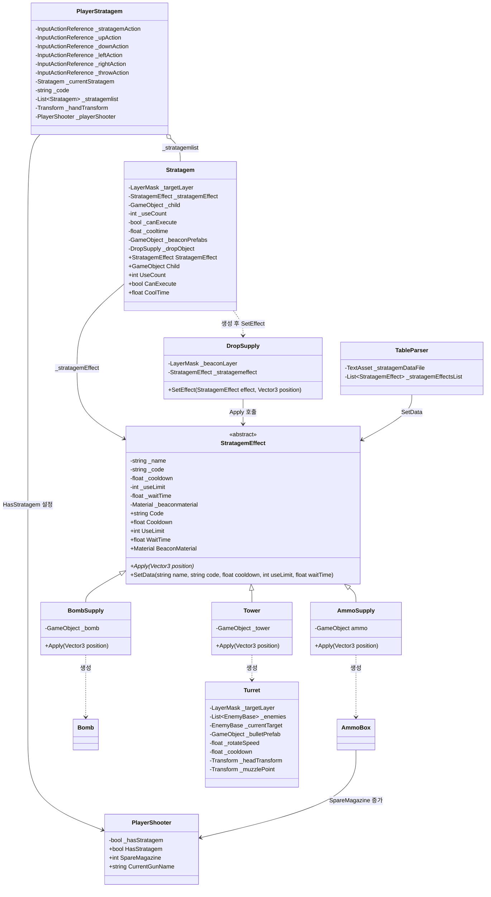
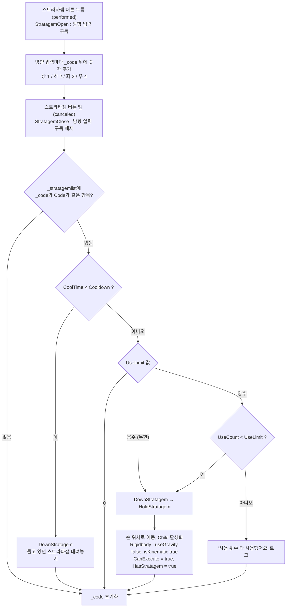
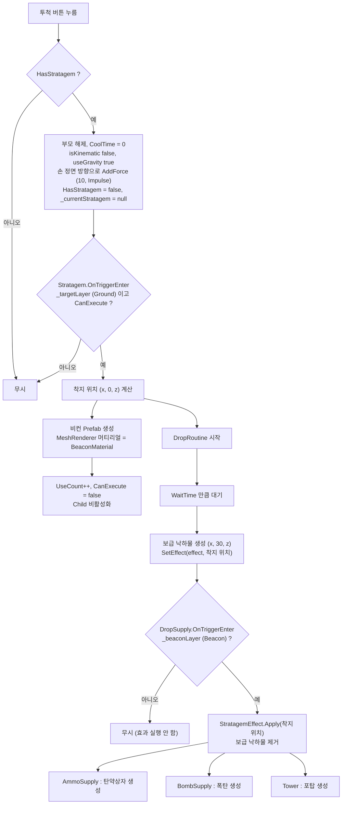
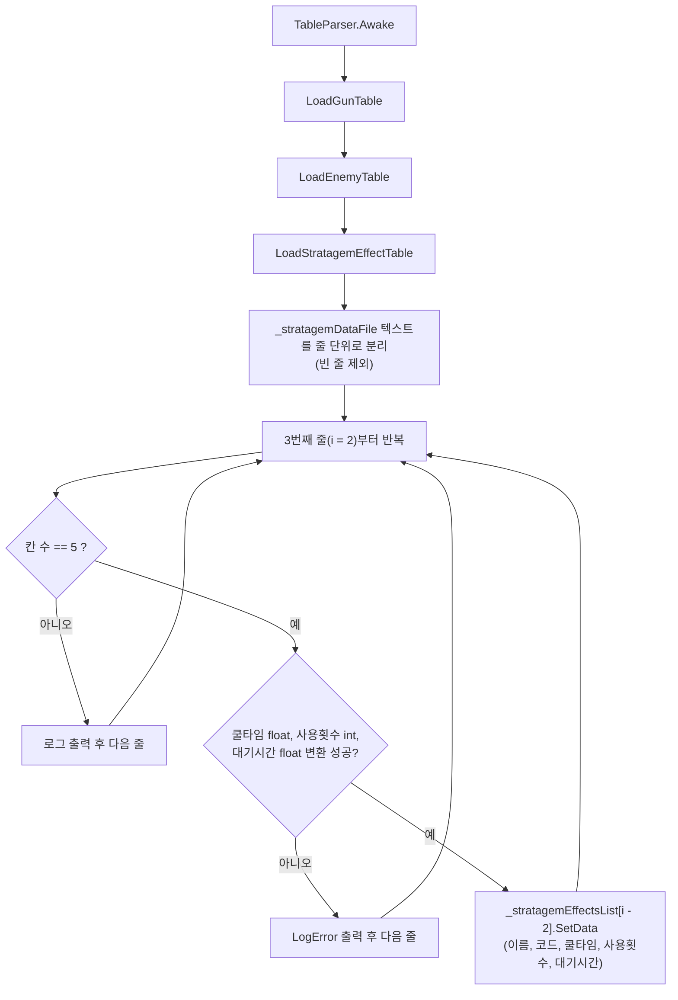

# 스트라타잼 시스템

> 스트라타잼 버튼을 누른 채 상/하/좌/우 입력 액션으로 코드를 입력해 스트라타잼을 들고 던져, 착지한 비컨 위치에 보급 낙하물을 떨어뜨리고 효과(탄약 보급, 폭격, 포탑)를 실행하는 시스템.
>
> 관련 Issue : #36 (코드 입력), #37 (비컨 투척), #38 (지원 효과), #39 (데이터 외부 관리)

---

## 1. 클래스 구성과 책임

| 클래스 | 위치 | 책임 |
|---|---|---|
| `PlayerStratagem` | `Scripts/Gameplay/Player/PlayerStratagem.cs` | 스트라타잼 코드 입력을 받아 일치하는 스트라타잼을 찾고, 쿨타임·사용 횟수를 확인해 손에 들거나 내려놓고, 투척 입력 시 들고 있는 스트라타잼을 던진다. |
| `PlayerShooter` | `Scripts/Gameplay/Player/PlayerShooter.cs` | (이 시스템 관련 부분만) `HasStratagem` 상태를 보관하고, 값이 `true`이면 사격 처리를 하지 않는다. |
| `Stratagem` | `Scripts/Gameplay/Stratagem/Stratagem.cs` | 씬에 배치된 개별 스트라타잼. 투척 후 경과 시간(`CoolTime`), 사용 횟수(`UseCount`), 실행 가능 여부(`CanExecute`)를 관리하고, 지면에 닿으면 비컨을 생성한 뒤 대기 시간 후 보급 낙하물을 생성한다. |
| `StratagemEffect` | `Scripts/Gameplay/Stratagem/StratagemEffect.cs` | 스트라타잼 효과의 추상 ScriptableObject. 이름·코드·쿨타임·사용 횟수·대기 시간·비컨 머티리얼을 보관하고, `SetData`로 데이터를 받으며, 효과 실행(`Apply`)을 하위 클래스에 맡긴다. |
| `AmmoSupply` | `Scripts/Gameplay/Stratagem/Effect/AmmoSupply.cs` | `StratagemEffect` 구현. 지정 위치에 탄약상자 Prefab을 생성한다. |
| `BombSupply` | `Scripts/Gameplay/Stratagem/Effect/BombSupply.cs` | `StratagemEffect` 구현. 지정 위치에 폭탄 Prefab을 생성한다. |
| `Tower` | `Scripts/Gameplay/Stratagem/Effect/Tower.cs` | `StratagemEffect` 구현. 지정 위치에 포탑 Prefab을 생성한다. |
| `DropSupply` | `Scripts/DropSupply.cs` | 보급 낙하물. 실행할 효과와 위치를 전달받아 두고, 비컨 레이어에 닿으면 효과의 `Apply`를 호출한 뒤 자신을 제거한다. |
| `TableParser` | `Scripts/TableParser.cs` | (이 시스템 관련 부분만) `LoadStratagemEffectTable`에서 스트라타잼 CSV를 읽어 `StratagemEffect` 에셋들에 `SetData`로 값을 넣는다. |
| `AmmoBox` | `Scripts/Gameplay/AmmoBox.cs` | 효과 결과물. `PlayerShooter`가 닿으면 현재 총이 `Pistol`이 아닐 때 예비 탄창을 3 늘리고 자신을 제거한다. |
| `Bomb` | `Scripts/Gameplay/Bomb.cs` | 효과 결과물. `IDamageable`이 닿으면 50 데미지를 주고 자신을 제거한다. |
| `Turret` | `Scripts/Gameplay/Turret.cs` | 효과 결과물. 트리거 범위 안의 적 중 시야가 확보된 가장 가까운 적을 조준해 쿨타임마다 총알을 발사하고, 생성 90초 후 자신을 제거한다. |



- `PlayerStratagem`은 같은 GameObject의 `PlayerShooter`를 `GetComponent`로 참조한다. 두 컴포넌트는 같은 오브젝트에 있어야 한다.
- `Stratagem` 오브젝트는 플레이어 하위가 아닌 씬에 배치되어 있고, `PlayerStratagem._stratagemlist`로 연결된다. 들 때만 `_handTransform`의 자식이 된다.
- 비컨은 별도 클래스 없이 `Stratagem._beaconPrefabs`(`Beacon.prefab`)를 생성해 표시하며, `DropSupply`는 비컨의 레이어로 착지 여부를 판단한다.
- `TableParser`는 총·적 데이터 로드도 함께 담당하며, 이 문서는 `LoadStratagemEffectTable`만 다룬다.
- 효과 결과물은 다른 시스템을 참조한다.
    - `AmmoBox` → `PlayerShooter`(`CurrentGunName`, `SpareMagazine`)
    - `Bomb` → `IDamageable`(`TakeDamage`)
    - `Turret` → `EnemyBase`(`IsDead`)

---

## 2. 동작 흐름

### 2-1. 코드 입력 · 들기



- 코드는 방향 입력 순서대로 숫자를 이어 붙인 문자열이며, `StratagemEffect.Code`와 문자열로 비교한다.
- 코드 판정은 스트라타잼 버튼을 **뗄 때** 한 번만 한다. 방향 입력은 버튼을 누르고 있는 동안에만 구독된다.
- 쿨타임이 지나지 않은 스트라타잼의 코드를 입력하면, 이미 들고 있던 스트라타잼도 내려놓는다.
- 다른 스트라타잼을 들고 있는 상태에서 새 스트라타잼을 들면, 기존 스트라타잼은 `DownStratagem`으로 `Child`가 비활성화되고 부모 관계가 해제된다.
- 버튼을 뗀 뒤 `_currentStratagem`이 `null`이면 `"같은 코드가 없어요"` 로그가 출력된다. 사용 횟수를 모두 쓴 경우에도 들고 있는 스트라타잼이 없으면 이 로그가 함께 출력된다.
- 일치 검사 반복문은 일치 항목을 찾아도 멈추지 않고 목록 끝까지 진행한다. 같은 코드를 가진 항목이 여러 개일 때는 아래와 같이 처리된다.
    - 쿨타임이 지나지 않은 항목을 만나면 `DownStratagem`으로 들고 있던 스트라타잼(이 반복 중에 든 것 포함)을 내려놓고, `_code`를 초기화한 뒤 `return`으로 반복 전체를 끝낸다. 뒤에 남은 항목은 검사하지 않으며, `"같은 코드가 없어요"` 로그 검사도 실행되지 않는다.
    - 사용 횟수를 모두 쓴 항목(`UseLimit`이 `0`이거나 `UseCount`가 `UseLimit` 이상)은 들리지 않는다. 이때 들고 있던 스트라타잼은 내려놓지 않고 그대로 유지된다.
    - 들 수 있는 항목을 만날 때마다 `DownStratagem` → `HoldStratagem`이 실행되므로, 반복이 끝까지 진행되면 마지막으로 조건을 통과한 항목이 손에 남는다.
- `DownStratagem`은 `CanExecute`를 `false`로 바꾸고 `Child`를 비활성화한 뒤 부모 관계만 해제한다. `HoldStratagem`에서 바꾼 Rigidbody 상태(`isKinematic` `true`, `useGravity` `false`)는 되돌리지 않는다. 내려놓은 뒤의 물리 동작은 확인되지 않았다. (미검증)
- `Stratagem.Update`는 `_canExecute`가 `true`인 동안 매 프레임 `_child.SetActive(true)`를 호출한다. 들고 있는 동안이나 투척 후 착지 전에는 다른 곳에서 `Child`를 비활성화해도 다음 프레임에 다시 활성화된다.
- `HasStratagem`이 `true`인 동안 `PlayerShooter`는 사격 처리를 하지 않는다.

### 2-2. 투척 · 착지 · 낙하 · 효과 실행



- `CoolTime`은 `Stratagem.Update`에서 항상 증가하고, 투척 시 0으로 초기화된다. 즉 쿨타임은 마지막 투척 이후 경과 시간으로 판정한다.
- `UseCount`는 투척 시점이 아니라 지면에 닿아 비컨이 생성될 때 증가한다.
- 착지 위치의 y는 0으로 고정되며, 비컨·보급 낙하물(x, z 기준)·효과 결과물 모두 이 위치를 기준으로 생성된다.
- 비컨 머티리얼 적용은 비컨 Prefab 루트의 `MeshRenderer`를 `GetComponent`로 가져온다. 루트에 `MeshRenderer`가 있어야 한다.
- 코드상 생성된 비컨 오브젝트를 제거하는 처리는 없다.
- `DropSupply`에는 이동 코드가 없다. 보급 낙하물이 떨어지는 동작은 `DropCylinder.prefab`의 물리 설정에 따른다. (미검증)
- 투척된 `Stratagem` 오브젝트는 제거되지 않고 착지 위치에 남으며, `Child`만 비활성화된다. 다음에 같은 코드로 들면 같은 오브젝트가 다시 손으로 이동한다.
- 효과 결과물 동작 (핵심만)
    - `AmmoBox` : 플레이어가 닿으면 현재 총이 `Pistol`이 아닐 때 `SpareMagazine`을 3 늘리고 제거된다.
    - `Bomb` : `IDamageable`이 닿으면 `TakeDamage(50)`을 호출하고 제거된다. `IDamageable`이 아닌 대상에 닿으면 제거되지 않는다.
    - `Turret` : 생성 90초 후 제거된다. `_targetLayer` 적을 목록에 넣고, Raycast로 시야가 확보된 가장 가까운 적을 조준해 `_cooldown`마다 총알을 생성한다. 조준 대상이 없거나 쿨타임이 차지 않았으면 발사하지 않는다.
- Play 테스트에서 세 효과(탄약 보급, 폭격, 포탑)가 동작하는 것을 확인했다. 그 외 세부 동작(예외 상황, 연속 사용 등)은 미검증이다.

### 2-3. 데이터 로드



- `TableParser.Awake`는 `LoadGunTable` → `LoadEnemyTable` → `LoadStratagemEffectTable` 순서로 호출한다. 앞의 두 로드는 이 문서 범위 밖이지만, 앞 단계에서 예외가 발생하면 스트라타잼 데이터 로드는 실행되지 않는다.
- CSV의 1번째 줄(헤더)과 2번째 줄(자료형)은 읽지 않는다.
- CSV 열 순서 : `이름, 코드, 쿨타임, 사용횟수, 대기시간`
- **주의** : CSV 데이터 행은 줄 순서대로 `_stratagemEffectsList`의 같은 순서 항목에 들어간다. CSV 행 순서(현재 `Tower` → `AmmoSupply` → `Bomb`)와 `TableParser`의 `_stratagemEffectsList` Inspector 순서가 일치해야 데이터가 올바르게 들어간다.
- CSV 데이터 행 수가 `_stratagemEffectsList` 항목 수보다 많으면 리스트 인덱스 범위를 벗어난다.
- 런타임 상태(`UseCount`, `CoolTime`, `CanExecute`)는 ScriptableObject가 아닌 각 `Stratagem` 컴포넌트에 저장된다.

---

## 3. Inspector 설정 가이드

### 오브젝트 구성

```text
[플레이어 오브젝트]
└─ PlayerShooter, PlayerStratagem          (같은 오브젝트에 부착)

[씬 오브젝트] Stratagem × N                 (플레이어 하위가 아닌 씬에 배치)
└─ Stratagem
   └─ Child (_child)                        (손에 들었을 때 표시되는 오브젝트)
   ※ 자신 또는 하위에 Rigidbody 필요 (GetComponentInChildren<Rigidbody>)

[씬 오브젝트] TableParser                    (부착 오브젝트 미검증)

Prefab
├─ Beacon.prefab       : 루트에 MeshRenderer, Beacon 레이어 Collider
├─ DropCylinder.prefab : DropSupply (보급 낙하물)
├─ AmmoBox.prefab      : AmmoBox
├─ Bomb.prefab         : Bomb
└─ Tower.prefab        : Turret
```

- 각 Prefab의 Collider·Rigidbody·레이어 구성 값은 확인되지 않았다. 위 Prefab 항목은 코드가 요구하는 조건을 적은 것이다. (미검증)

### `PlayerStratagem`

| 필드 | 설명 |
|---|---|
| `_stratagemAction` | 스트라타잼 버튼. 누르면 방향 입력 구독, 떼면 코드 판정 |
| `_upAction` / `_downAction` / `_leftAction` / `_rightAction` | 방향 입력. 각각 코드에 `1` / `2` / `3` / `4`를 추가 |
| `_throwAction` | 투척 버튼 |
| `_currentStratagem` | 현재 들고 있는 스트라타잼 (런타임 상태, 들 때 설정, 투척·내려놓을 때 `null`) |
| `_code` | 입력 중인 코드 (런타임 상태, 방향 입력마다 1~4를 이어 붙이고 판정 후 `null`) |
| `_stratagemlist` | 사용할 수 있는 씬의 `Stratagem` 목록 |
| `_handTransform` | 스트라타잼을 드는 위치. `forward` 방향이 투척 방향 |

- 입력 구성 기준은 `TechSpec.md` › 유저 입력 시스템, `UNITY_GUIDELINES.md` 05-4를 참고한다.
- 액션별 키 바인딩은 확인되지 않았다. (미검증)

### `PlayerShooter` (스트라타잼 부분)

| 필드 | 설명 |
|---|---|
| `_hasStratagem` | 스트라타잼을 들고 있는지 여부 (런타임 상태, `PlayerStratagem`이 들 때 `true`, 투척·내려놓을 때 `false`). `true`인 동안 사격 처리를 하지 않음 |

### `Stratagem`

| 필드 | 설명 |
|---|---|
| `_targetLayer` | 착지로 판정할 레이어. 설정 값 : `Ground` |
| `_stratagemEffect` | 이 스트라타잼이 실행할 효과 에셋 (`StratagemEffect`) |
| `_child` | 손에 들었을 때 표시하고, 착지 후 숨기는 오브젝트 |
| `_useCount` | 사용 횟수 (런타임 상태, 착지 시 증가) |
| `_canExecute` | 착지 시 효과 실행 가능 여부 (런타임 상태, 들 때 `true`) |
| `_cooltime` | 마지막 투척 이후 경과 시간 (런타임 상태) |
| `_beaconPrefabs` | 착지 위치에 생성할 비컨 Prefab (`Beacon.prefab`) |
| `_dropObject` | 대기 시간 후 생성할 보급 낙하물 (`DropCylinder.prefab`의 `DropSupply`) |

### `StratagemEffect` 에셋 (`AmmoSupply` / `BombSupply` / `Tower`)

- 에셋 위치 : `ScriptableObject/Stratagem/AmmoSupply.asset`, `BombSupply.asset`, `TowerSupply.asset`

| 필드 | 설명 | 테스트 값 (`StratagemTable.csv`) |
|---|---|---|
| `_name` | 이름. 실행 시 CSV 값으로 덮어씀 | `Tower` / `AmmoSupply` / `Bomb` |
| `_code` | 입력 코드. 실행 시 CSV 값으로 덮어씀 | `1234` / `4321` / `1324` |
| `_cooldown` | 투척 후 다시 들 수 있을 때까지의 시간. 실행 시 CSV 값으로 덮어씀 | `0` / `30` / `0` |
| `_useLimit` | 사용 가능 횟수. 음수 = 무한, `0` = 사용 불가. 실행 시 CSV 값으로 덮어씀 | `3` / `-1` / `2` |
| `_waitTime` | 착지 후 보급 낙하물 생성까지 대기 시간. 실행 시 CSV 값으로 덮어씀 | `30` / `10` / `15` |
| `_beaconmaterial` | 생성되는 비컨에 적용할 머티리얼 | |
| `ammo` / `_bomb` / `_tower` | 효과 실행 시 생성할 Prefab (클래스별 필드) | |

- 테스트 값은 `Tower` / `AmmoSupply` / `Bomb` 행 순서로 기재했다.

### `DropSupply`

| 필드 | 설명 |
|---|---|
| `_beaconLayer` | 효과 실행 조건이 되는 비컨 레이어. 설정 값 : `Beacon` |

### `TableParser` (스트라타잼 부분)

| 필드 | 설명 |
|---|---|
| `_stratagemDataFile` | 스트라타잼 CSV (`Data/StratagemTable.csv`) |
| `_stratagemEffectsList` | 데이터를 넣을 `StratagemEffect` 에셋 목록. **CSV 데이터 행 순서와 같은 순서로 등록** |

### `Turret`

| 필드 | 설명 |
|---|---|
| `_targetLayer` | 공격 대상(적) 레이어 |
| `_enemies` | 트리거 범위에 들어온 적 목록 (런타임 상태, 범위를 나가거나 죽은 적은 제거) |
| `_currentTarget` | 현재 조준 대상 (런타임 상태, 매 프레임 시야가 확보된 가장 가까운 적으로 갱신) |
| `_bulletPrefab` | 발사할 총알 Prefab |
| `_rotateSpeed` | 대상이 없을 때 머리 회전 속도 |
| `_cooldown` | 발사 간격 |
| `_headTransform` | 회전·조준하는 머리 Transform |
| `_muzzlePoint` | 총알 생성 위치, 시야 Raycast 시작점 |

- `Turret` Prefab 설정 값은 확인되지 않았다. (미검증)

### 레이어

- `Ground` : `Stratagem._targetLayer`. 스트라타잼이 이 레이어에 닿으면 착지로 처리한다.
- `Beacon` : `DropSupply._beaconLayer`. 보급 낙하물이 이 레이어에 닿으면 효과를 실행한다. 비컨 Prefab이 이 레이어여야 한다. (미검증)

### 테스트 환경

- 씬 : `Scenes/SampleScene.unity`

---

## 4. 설계 결정 기록

| 항목 | 결정 | 이유 |
|---|---|---|
| 효과 구조 | `StratagemEffect` ScriptableObject 추상 클래스를 상속해 효과별 클래스 작성 | 각 효과의 스탯과 동작을 관리하기 위해 |
| 효과 실행 시점 | 비컨 착지 → 대기 시간 후 높이 30에서 보급 낙하물 생성 → 낙하물이 비컨에 닿으면 효과 실행 | 하늘에서 보급이 떨어지는 것처럼 보이게 하기 위해 |
| 무한 사용 표현 | `UseLimit` 음수 = 무한 사용, `0`이 아닐 때만 사용 가능 | 무한 사용과 횟수 제한을 함께 관리하는 방법으로, 사용 횟수는 양수로 관리하므로 int의 음수를 무한으로 사용 |
| 데이터 관리 | 스트라타잼 데이터를 CSV로 외부 관리 | 외부에서 데이터를 관리하기 위해 |
| 사용 횟수 증가 시점 | 투척 시점이 아닌 착지(비컨 생성) 시점에 `UseCount` 증가 | 발동하는 시점을 기준으로 하기 위해 |
| 쿨타임 기준 | 투척 시 `CoolTime`을 0으로 초기화하고 경과 시간으로 판정 | |
| 런타임 상태 위치 | `UseCount`, `CoolTime`, `CanExecute`를 ScriptableObject가 아닌 `Stratagem` 컴포넌트에 저장 | ScriptableObject에는 변하지 않는 값만 저장하기 위해 |
| 스트라타잼 오브젝트 재사용 | 씬에 배치된 `Stratagem`을 들 때마다 손으로 옮겨 재사용 (매번 생성하지 않음) | `UseCount`, `CoolTime`처럼 한 오브젝트에서 관리해야 하기 때문에 |
